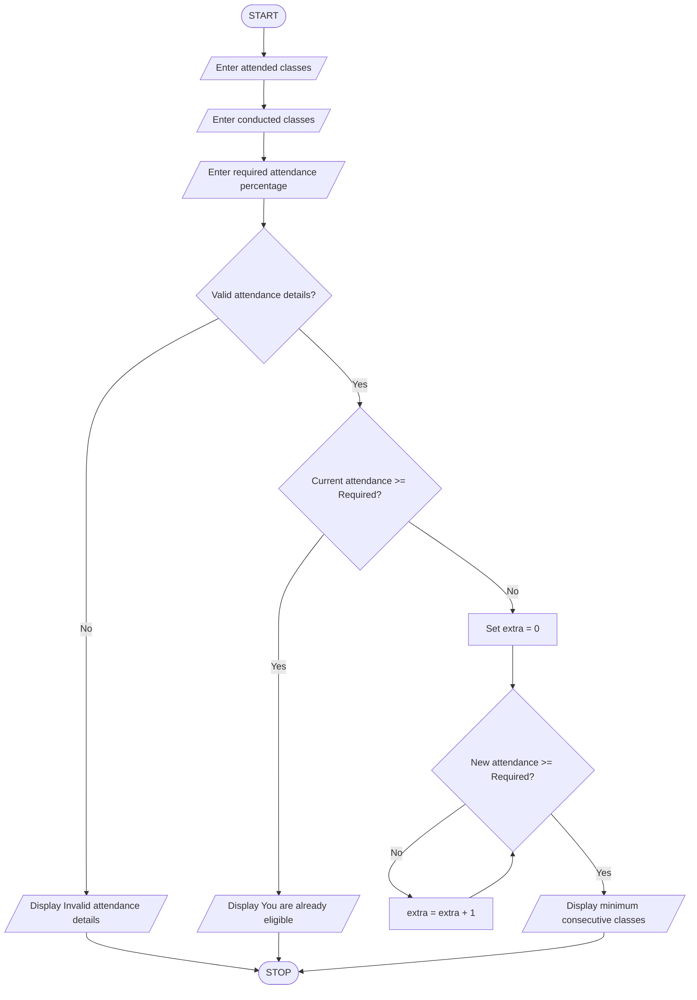

### Student Attendance Eligibility Calculator Using Python

### 1\. Problem Statement

Write a Python program to check whether a student is eligible based on their attendance percentage.

The program should:

* Accept the number of classes attended.

* Accept the total number of classes conducted.

* Accept the required attendance percentage.

* Validate the attendance details.

* Calculate the current attendance percentage.

* If the student already meets the required attendance, display "You are already eligible".

* Otherwise, calculate the minimum number of consecutive classes the student must attend to reach the required attendance percentage.

* Display the minimum number of classes to attend.

### 2\. Algorithm

* Start the program.

* Enter the number of classes attended.

* Enter the total number of classes conducted.

* Enter the required attendance percentage.

* Check whether the attendance details are valid.

* If total classes are zero, attended classes are negative, or attended classes exceed conducted classes, display "Invalid attendance details".

* Otherwise, calculate the attendance percentage.

* Check whether the attendance percentage is greater than or equal to the required percentage.

* If yes, display "You are already eligible".

* Otherwise:

    * Initialize extra classes to zero.

    * Use a while loop to calculate attendance after attending additional consecutive classes.

    * Increase extra classes by one until the required percentage is reached.

* Display the minimum consecutive classes to attend.

* Stop the program.

### 3\. Pseudocode

```text
START

INPUT attended
INPUT conducted
INPUT required

IF conducted <= 0 OR attended < 0
   OR attended > conducted THEN

    DISPLAY "Invalid attendance details"

ELSE IF (attended * 100 / conducted) >= required THEN

    DISPLAY "You are already eligible"

ELSE

    extra = 0

    WHILE ((attended + extra) * 100 /
          (conducted + extra)) < required DO

        extra = extra + 1

    END WHILE

    DISPLAY "Minimum consecutive classes to attend:", extra

END IF

STOP
```

### 4\. Flowchart (Mermaid)



### 5\. Sample Input

```text
Enter classes attended: 60
Enter total classes conducted: 100
Enter required attendance percentage: 75
```

### 6\. Sample Output

```text
Minimum consecutive classes to attend: 60
```

### 7\. Calculation

* Classes attended = 60

* Total classes conducted = 100

* Required attendance = 75%

* Current attendance = 60%

After attending 60 additional consecutive classes:

\\frac{60+60}{100+60}\\times100=75\\%

Therefore, the student must attend 60 more consecutive classes to reach 75% attendance.

Concepts used: Variables, data types, arithmetic operators, if-elif-else conditions, logical operators, while loop, and input/output statements.
