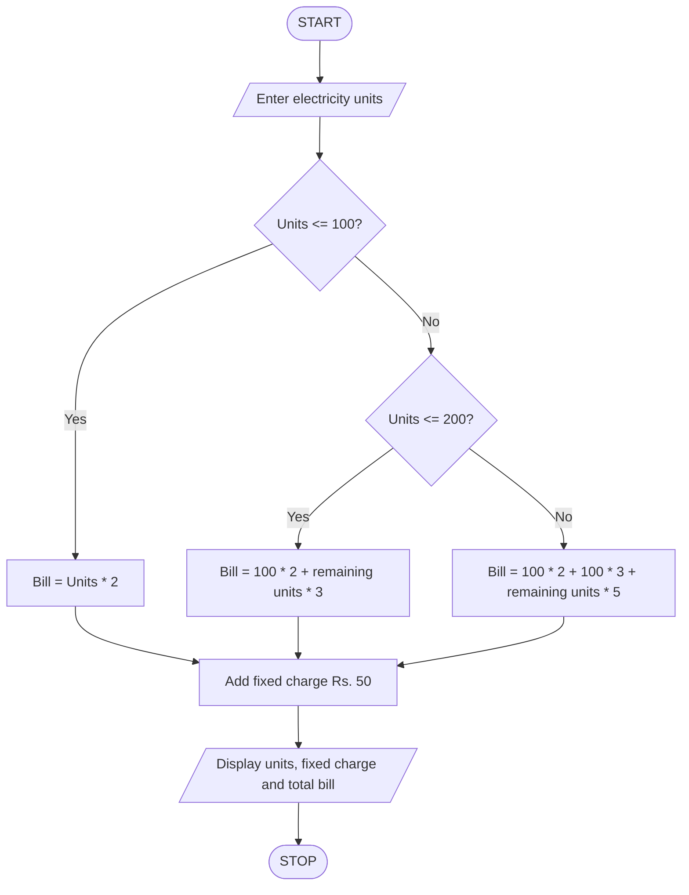

### Electricity Bill Calculator Using Python

### 1\. Problem Statement

Write a Python program to calculate the electricity bill based on the number of units consumed by a customer.

The program should:

* Accept the number of electricity units consumed.

* Calculate charges based on different unit slabs.

* For the first 100 units, charge Rs. 2 per unit.

* For 101–200 units, charge Rs. 3 per unit for additional units.

* Above 200 units, charge Rs. 5 per additional unit.

* Add a fixed charge of Rs. 50 to the bill.

* Display the total units consumed, fixed charge, and final electricity bill.

### 2\. Algorithm

* Start the program.

* Enter the electricity units consumed.

* Check whether units are less than or equal to 100.

* If yes, calculate bill as units × 2.

* Otherwise, check whether units are less than or equal to 200.

* If yes, calculate bill as (100 × 2) + (units − 100) × 3.

* Otherwise, calculate bill as (100 × 2) + (100 × 3) + (units − 200) × 5.

* Add Rs. 50 as a fixed charge.

* Display the units consumed.

* Display the fixed charge.

* Display the total electricity bill.

* Stop the program.

### 3\. Pseudocode

```text
START

INPUT units

IF units <= 100 THEN
    bill = units * 2

ELSE IF units <= 200 THEN
    bill = (100 * 2) + (units - 100) * 3

ELSE
    bill = (100 * 2) + (100 * 3)
           + (units - 200) * 5

END IF

bill = bill + 50

DISPLAY units
DISPLAY "Fixed charge: Rs. 50"
DISPLAY "Total electricity bill:", bill

STOP
```

### 4\. Flowchart (Mermaid)



### 5\. Sample Input

```text
Enter electricity units: 250
```

### 6\. Sample Output

```text
Units consumed: 250
Fixed charge: Rs. 50
Total electricity bill: Rs. 800
```

### 7\. Calculation

* First 100 units = 100 × 2 = Rs. 200

* Next 100 units = 100 × 3 = Rs. 300

* Remaining 50 units = 50 × 5 = Rs. 250

* Fixed charge = Rs. 50

Total bill = 200 + 300 + 250 + 50 = Rs. 800

