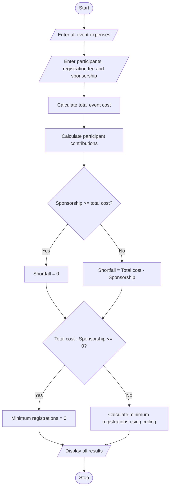

### Case Study 10: Campus Event Financial Planning

### 1\. Problem Statement

To develop a Python program to calculate the total expenses of a college event, including venue, equipment, catering, transport, and certificate costs. The program calculates participant contributions, sponsorship shortfall, and the minimum number of registrations required to break even.

### 2\. Algorithm

* Start.

* Enter venue, equipment, catering, transport, and certificate costs.

* Enter the number of expected participants.

* Enter the registration fee per participant.

* Enter the sponsorship amount.

* Calculate total event expenses.

* Calculate participant contributions.

* Calculate the sponsorship shortfall.

* Calculate the minimum registrations required to break even.

* Display all results.

* Stop.

### 3\. Pseudocode

```text
START

INPUT venue cost
INPUT equipment cost
INPUT catering cost
INPUT transport cost
INPUT certificate cost

INPUT expected participants
INPUT registration fee
INPUT sponsorship amount

total_cost = venue + equipment + catering
             + transport + certificate

participant_contribution = expected participants
                           * registration_fee

IF sponsorship < total_cost THEN
    shortfall = total_cost - sponsorship
ELSE
    shortfall = 0
END IF

remaining = total_cost - sponsorship

IF remaining <= 0 THEN
    minimum_registrations = 0
ELSE
    minimum_registrations = CEILING(remaining / registration_fee)
END IF

DISPLAY total_cost
DISPLAY participant_contribution
DISPLAY shortfall
DISPLAY minimum_registrations

STOP
```

### 4\. Flowchart



### 5\. Sample Input

| Details               | Amount     |
| --------------------- | ---------- |
| Venue cost            | Rs. 10,000 |
| Equipment cost        | Rs. 5,000  |
| Catering cost         | Rs. 15,000 |
| Transport cost        | Rs. 3,000  |
| Certificate cost      | Rs. 2,000  |
| Expected participants | 100        |
| Registration fee      | Rs. 200    |
| Sponsorship amount    | Rs. 20,000 |

### 6\. Python Program

```python
import math

venue = float(input("Enter venue cost: "))
equipment = float(input("Enter equipment cost: "))
catering = float(input("Enter catering cost: "))
transport = float(input("Enter transport cost: "))
certificates = float(input("Enter certificate cost: "))

participants = int(input("Enter expected participants: "))
fee = float(input("Enter registration fee per participant: "))
sponsorship = float(input("Enter sponsorship amount: "))

total_cost = venue + equipment + catering + transport + certificates

participant_contribution = participants * fee

shortfall = max(0, total_cost - sponsorship)

remaining = total_cost - sponsorship

if remaining <= 0:
    minimum_registrations = 0
else:
    minimum_registrations = math.ceil(remaining / fee)

print("\nTotal event cost: Rs.", total_cost)
print("Participant contributions: Rs.", participant_contribution)
print("Sponsorship shortfall: Rs.", shortfall)
print("Minimum registrations required:", minimum_registrations)
```

### 7\. Sample Output

```text
Enter venue cost: 10000
Enter equipment cost: 5000
Enter catering cost: 15000
Enter transport cost: 3000
Enter certificate cost: 2000
Enter expected participants: 100
Enter registration fee per participant: 200
Enter sponsorship amount: 20000

Total event cost: Rs. 35000.0
Participant contributions: Rs. 20000.0
Sponsorship shortfall: Rs. 15000.0
Minimum registrations required: 75
```

Calculation:

* Total cost = Rs. 35,000

* Participant contribution = 100 × 200 = Rs. 20,000

* Sponsorship shortfall = 35,000 − 20,000 = Rs. 15,000

* Minimum registrations = 15,000 ÷ 200 = 75 participants

Note: The minimum registration calculation assumes the sponsorship amount is fixed and every registered participant pays the full registration fee.
