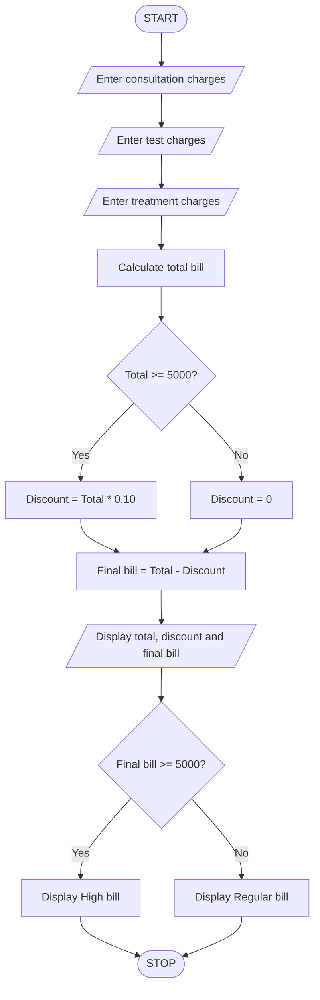

### Hospital Billing and Discount Calculator Using Python

### 1\. Problem Statement

Write a Python program to calculate a patient's hospital bill based on consultation charges, test charges, and treatment charges.

The program should:

* Accept consultation charges.

* Accept medical test charges.

* Accept treatment charges.

* Calculate the total bill.

* Provide a 10% discount if the total bill is Rs. 5,000 or above.

* Calculate the final bill after discount.

* Classify the bill as a High Bill or Regular Bill based on the final amount.

### 2\. Algorithm

* Start the program.

* Enter consultation charges.

* Enter test charges.

* Enter treatment charges.

* Calculate the total bill by adding all charges.

* Check whether the total bill is greater than or equal to Rs. 5,000.

* If yes, calculate a 10% discount.

* Otherwise, set the discount to zero.

* Calculate the final bill by subtracting the discount from the total bill.

* Display the total bill, discount, and final bill.

* Check whether the final bill is greater than or equal to Rs. 5,000.

* If yes, display "High bill".

* Otherwise, display "Regular bill".

* Stop the program.

### 3\. Pseudocode

```text
START

INPUT consultation
INPUT tests
INPUT treatment

total = consultation + tests + treatment

IF total >= 5000 THEN
    discount = total * 0.10
ELSE
    discount = 0
END IF

final_bill = total - discount

DISPLAY total
DISPLAY discount
DISPLAY final_bill

IF final_bill >= 5000 THEN
    DISPLAY "High bill"
ELSE
    DISPLAY "Regular bill"
END IF

STOP
```

### 4\. Flowchart (Mermaid)



### 5\. Sample Input

```text
Enter consultation charge: 2000
Enter test charges: 2500
Enter treatment charges: 2000
```

### 6\. Sample Output

```text
Total bill: Rs. 6500.0

Discount: Rs. 650.0

Final bill: Rs. 5850.0

Classification: High bill
```
