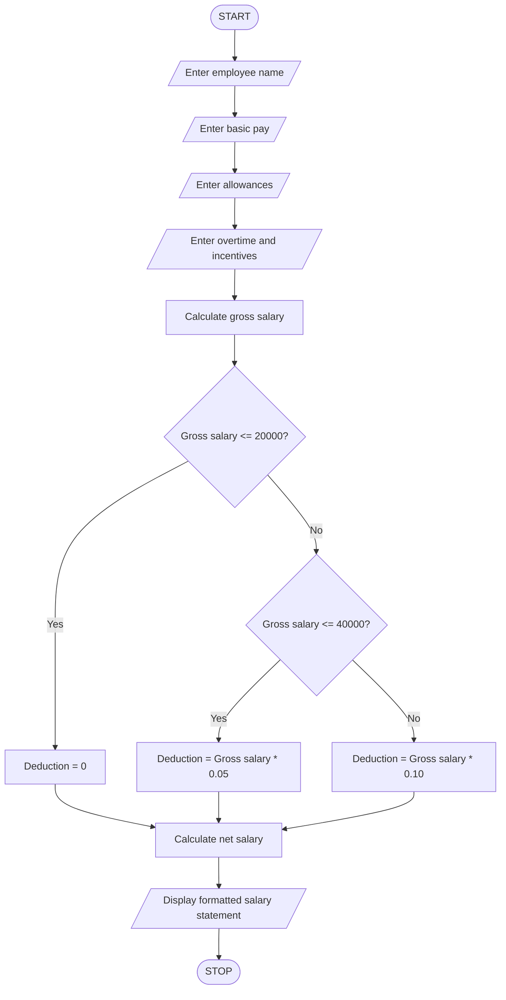

### Employee Payroll and Deduction Analysis Using Python

### 1\. Problem Statement

Write a Python program to calculate an employee's gross salary based on basic pay, allowances, overtime, and incentives.

The program should:

* Accept employee name and basic salary.

* Accept allowances, overtime pay, and incentives.

* Calculate gross salary by adding all earnings.

* Apply progressive deductions based on gross salary.

* Calculate the net salary after deductions.

* Generate and display a formatted salary statement.

Assumed deduction rules for this program:

* Gross salary up to Rs. 20,000: No deduction.

* Gross salary above Rs. 20,000 and up to Rs. 40,000: 5% deduction.

* Gross salary above Rs. 40,000: 10% deduction.

### 2\. Algorithm

* Start the program.

* Enter employee name.

* Enter basic salary.

* Enter allowances.

* Enter overtime pay.

* Enter incentives.

* Calculate gross salary by adding basic salary, allowances, overtime, and incentives.

* Check the gross salary:

    * If gross salary is less than or equal to Rs. 20,000, deduction is zero.

    * If gross salary is less than or equal to Rs. 40,000, apply 5% deduction.

    * Otherwise, apply 10% deduction.

* Calculate net salary by subtracting deductions from gross salary.

* Display the employee salary statement.

* Stop the program.

### 3\. Pseudocode

```text
START

INPUT employee_name
INPUT basic_pay
INPUT allowances
INPUT overtime
INPUT incentives

gross_salary = basic_pay + allowances
               + overtime + incentives

IF gross_salary <= 20000 THEN
    deduction = 0

ELSE IF gross_salary <= 40000 THEN
    deduction = gross_salary * 0.05

ELSE
    deduction = gross_salary * 0.10

END IF

net_salary = gross_salary - deduction

DISPLAY employee_name
DISPLAY basic_pay
DISPLAY allowances
DISPLAY overtime
DISPLAY incentives
DISPLAY gross_salary
DISPLAY deduction
DISPLAY net_salary

STOP
```

### 4\. Flowchart (Mermaid)



### 5\. Sample Input

```text
Enter employee name: Ravi
Enter basic pay: 25000
Enter allowances: 5000
Enter overtime: 2000
Enter incentives: 3000
```

### 6\. Sample Output

```text
========== EMPLOYEE SALARY STATEMENT ==========

Employee Name: Ravi

Basic Pay: Rs. 25000.0
Allowances: Rs. 5000.0
Overtime Pay: Rs. 2000.0
Incentives: Rs. 3000.0

Gross Salary: Rs. 35000.0
Total Deduction: Rs. 1750.0

Net Salary: Rs. 33250.0

===============================================
```

### 7\. Python Source Code

```python

name = input("Enter employee name: ")

basic_pay = float(input("Enter basic pay: "))
allowances = float(input("Enter allowances: "))
overtime = float(input("Enter overtime pay: "))
incentives = float(input("Enter incentives: "))

gross_salary = basic_pay + allowances + overtime + incentives

if gross_salary <= 20000:
    deduction = 0
elif gross_salary <= 40000:
    deduction = gross_salary * 0.05
else:
    deduction = gross_salary * 0.10

net_salary = gross_salary - deduction

print("\n===== EMPLOYEE SALARY STATEMENT =====")

print("Employee Name:", name)
print("Basic Pay: Rs.", basic_pay)
print("Allowances: Rs.", allowances)
print("Overtime Pay: Rs.", overtime)
print("Incentives: Rs.", incentives)

print("Gross Salary: Rs.", gross_salary)
print("Total Deduction: Rs.", deduction)
print("Net Salary: Rs.", net_salary)

print("=====================================")
```

Concepts used: Variables, data types, arithmetic operators, input/output statements, if-elif-else conditions, and formatted output.

Note: The deduction percentages are assumed for this academic exercise and are not official tax or payroll rules.
