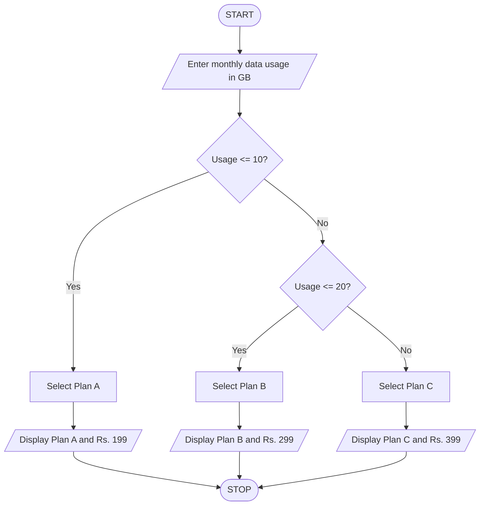

### Mobile Data Plan Recommendation Using Python

### 1\. Problem Statement

Write a Python program to recommend the best mobile data plan based on a customer's monthly data usage in GB.

The program should:

* Accept monthly data usage in GB.

* Define three mobile data plans with different prices.

* Recommend Plan A (Rs. 199) if usage is up to 10 GB.

* Recommend Plan B (Rs. 299) if usage is above 10 GB and up to 20 GB.

* Recommend Plan C (Rs. 399) if usage is above 20 GB.

* Display the recommended plan and its cost.

### 2\. Algorithm

* Start the program.

* Enter monthly data usage in GB.

* Initialize Plan A cost as Rs. 199.

* Initialize Plan B cost as Rs. 299.

* Initialize Plan C cost as Rs. 399.

* Check whether usage is less than or equal to 10 GB.

* If yes, recommend Plan A and display its cost.

* Otherwise, check whether usage is less than or equal to 20 GB.

* If yes, recommend Plan B and display its cost.

* Otherwise, recommend Plan C and display its cost.

* Stop the program.

### 3\. Pseudocode

```text
START

INPUT usage

plan_a = 199
plan_b = 299
plan_c = 399

IF usage <= 10 THEN

    DISPLAY "Best plan: Plan A"
    DISPLAY "Cost:", plan_a

ELSE IF usage <= 20 THEN

    DISPLAY "Best plan: Plan B"
    DISPLAY "Cost:", plan_b

ELSE

    DISPLAY "Best plan: Plan C"
    DISPLAY "Cost:", plan_c

END IF

STOP
```

### 4\. Flowchart (Mermaid)



### 5\. Sample Input

```text
Enter monthly data usage in GB: 15
```

### 6\. Sample Output

```text
Best plan: Plan B
Cost: Rs. 299
```
