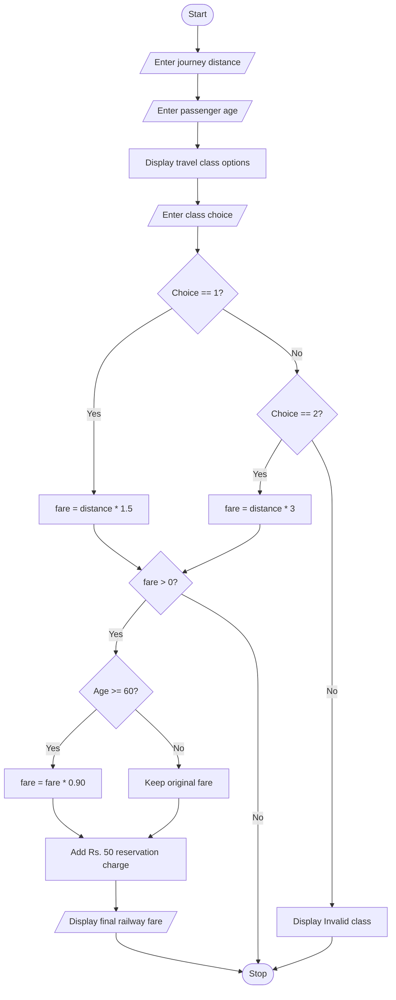

### Railway Fare Calculator Using Python

### 1\. Problem Statement

Write a Python program to calculate railway ticket fare based on the passenger's journey distance, age, and selected travel class.

The program should:

* Accept journey distance in kilometres.

* Accept passenger age.

* Allow the passenger to select Sleeper or AC class.

* Calculate fare based on the selected class.

* Provide a 10% concession for passengers aged 60 years or above.

* Add a reservation charge of Rs. 50.

* Display the final railway fare.

* Display an error message if an invalid class is selected.

### 2\. Algorithm

* Start.

* Input journey distance.

* Input passenger age.

* Display travel class options (Sleeper and AC).

* Input the selected class.

* If the selected class is Sleeper, calculate fare as distance × 1.5.

* If the selected class is AC, calculate fare as distance × 3.

* Otherwise, display "Invalid class".

* Check whether the fare is greater than zero.

* If age is 60 or above, apply a 10% concession.

* Add Rs. 50 as reservation charges.

* Display the final railway fare.

* Stop.

### 3\. Flowchart (Mermaid)



### 4\. Source Code (Python)

```python

distance = float(input("Enter journey distance in km: "))

age = int(input("Enter passenger age: "))

print("1. Sleeper")
print("2. AC")

choice = int(input("Choose class: "))

if choice == 1:
    fare = distance * 1.5

elif choice == 2:
    fare = distance * 3

else:
    fare = 0
    print("Invalid class")

if fare > 0:

    if age >= 60:
        fare = fare * 0.90

    fare = fare + 50

    print("Final railway fare: Rs.", fare)
```

### 5\. Sample Input

```text
Enter journey distance in km: 200
Enter passenger age: 65
1. Sleeper
2. AC
Choose class: 1
```

### 6\. Sample Output

```text
Final railway fare: Rs. 320.0
```

### 7\. Explanation of Output

* Journey distance = 200 km

* Passenger age = 65 years

* Travel class = Sleeper

* Sleeper fare = 200 × 1.5 = Rs. 300

* Senior concession = 10% of 300 = Rs. 30

* Fare after concession = 300 − 30 = Rs. 270

* Reservation charge = Rs. 50

Final fare = 270 + 50 = Rs. 320

### 8\. Pseudocode

```text
START

INPUT distance
INPUT age

DISPLAY "1. Sleeper"
DISPLAY "2. AC"

INPUT choice

IF choice == 1 THEN
    fare = distance * 1.5

ELSE IF choice == 2 THEN
    fare = distance * 3

ELSE
    fare = 0
    DISPLAY "Invalid class"

END IF

IF fare > 0 THEN

    IF age >= 60 THEN
        fare = fare * 0.90
    END IF

    fare = fare + 50

    DISPLAY "Final railway fare:", fare

END IF

STOP
```

Concepts used: Variables, input/output, data types, arithmetic operators, if-elif-else statements, and nested if conditions.
