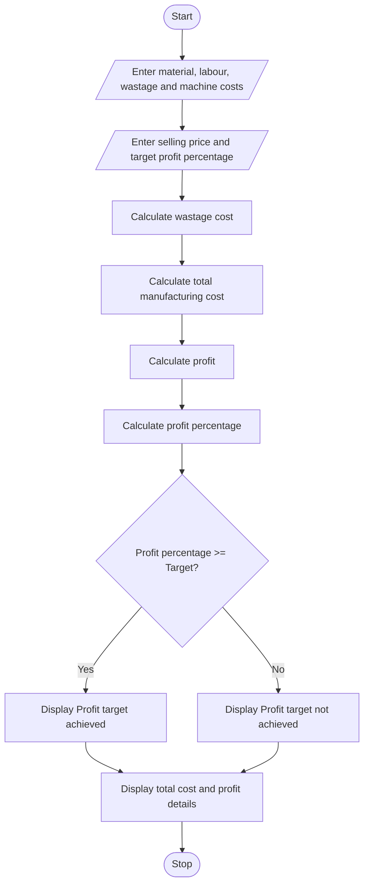

### Case Study 8: Manufacturing Cost and Profitability Analysis

### 1\. Problem Statement

To develop a Python program to calculate the total manufacturing cost of a product, including material costs, labour charges, wastage costs, and machine costs. The program calculates profit and identifies whether the product meets the specified profit target.

### 2\. Algorithm

* Start.

* Enter material cost, labour charges, wastage percentage, and machine cost.

* Enter selling price and target profit percentage.

* Calculate wastage cost.

* Calculate total manufacturing cost.

* Calculate profit.

* Calculate profit percentage.

* Compare profit percentage with the target profit percentage.

* If profit percentage is greater than or equal to the target, display "Profit target achieved".

* Otherwise, display "Profit target not achieved".

* Display all results.

* Stop.

### 3\. Pseudocode

```text
START

INPUT material_cost
INPUT labour_cost
INPUT wastage_percentage
INPUT machine_cost
INPUT selling_price
INPUT target_profit

wastage_cost = material_cost * wastage_percentage / 100

total_cost = material_cost + labour_cost
             + wastage_cost + machine_cost

profit = selling_price - total_cost

profit_percentage = (profit / total_cost) * 100

IF profit_percentage >= target_profit THEN
    DISPLAY "Profit target achieved"
ELSE
    DISPLAY "Profit target not achieved"
END IF

DISPLAY total_cost
DISPLAY profit
DISPLAY profit_percentage

STOP
```

### 4\. Flowchart



### 5\. Python Program

```python
material = float(input("Enter material cost: "))
labour = float(input("Enter labour charges: "))
wastage = float(input("Enter wastage percentage: "))
machine = float(input("Enter machine cost: "))
selling_price = float(input("Enter selling price: "))
target = float(input("Enter target profit percentage: "))

wastage_cost = material * wastage / 100

total_cost = material + labour + wastage_cost + machine

profit = selling_price - total_cost

profit_percentage = (profit / total_cost) * 100

print("\nWastage cost: Rs.", wastage_cost)
print("Total manufacturing cost: Rs.", total_cost)
print("Profit: Rs.", profit)
print("Profit percentage:", profit_percentage, "%")

if profit_percentage >= target:
    print("Profit target achieved")
else:
    print("Profit target not achieved")
```

### 6\. Sample Input

| Details                  | Amount     |
| ------------------------ | ---------- |
| Material cost            | Rs. 10,000 |
| Labour charges           | Rs. 3,000  |
| Wastage percentage       | 5%         |
| Machine cost             | Rs. 1,500  |
| Selling price            | Rs. 18,000 |
| Target profit percentage | 15%        |

```text
Enter material cost: 10000
Enter labour charges: 3000
Enter wastage percentage: 5
Enter machine cost: 1500
Enter selling price: 18000
Enter target profit percentage: 15
```

### 7\. Sample Output

```text
Wastage cost: Rs. 500.0
Total manufacturing cost: Rs. 15000.0
Profit: Rs. 3000.0
Profit percentage: 20.0 %
Profit target achieved
```

### Calculation

* Wastage cost = 10000 × 5 / 100 = Rs. 500

* Total cost = 10000 + 3000 + 500 + 1500 = Rs. 15,000

* Profit = 18000 − 15000 = Rs. 3,000

* Profit percentage = (3000 / 15000) × 100 = 20%

* Target = 15%

Result: The product achieves the specified profit target.

Note: This program assumes all costs and selling price are for the same production batch.
