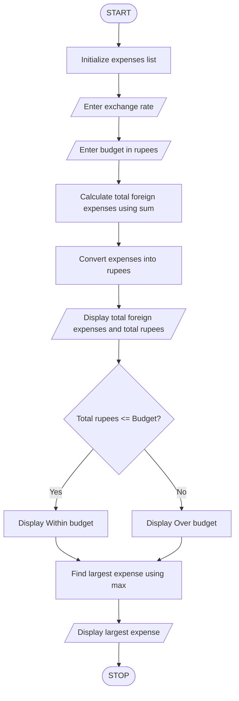

### Foreign Travel Expense and Budget Calculator Using Python

### 1\. Problem Statement

Write a Python program to calculate the total foreign travel expenses and convert them into Indian Rupees using the given exchange rate.

The program should:

* Store multiple foreign expenses in a list.

* Accept the exchange rate in rupees.

* Accept the total budget in rupees.

* Calculate the total foreign expenses using the `sum()` function.

* Convert the total expenses into Indian Rupees.

* Check whether the expenses are within the budget or over the budget.

* Display the largest expense using the `max()` function.

### 2\. Algorithm

* Start the program.

* Initialize a list containing foreign expenses.

* Enter the exchange rate in rupees.

* Enter the total budget in rupees.

* Calculate the total foreign expenses using `sum()`.

* Convert foreign expenses into Indian Rupees by multiplying the total expenses by the exchange rate.

* Display the total foreign expenses.

* Display the total expenses in Indian Rupees.

* Check whether the total expenses are less than or equal to the budget.

* If yes, display "Within budget".

* Otherwise, display "Over budget".

* Find the largest expense using `max()`.

* Display the largest expense.

* Stop the program.

### 3\. Pseudocode

```text
START

expenses = [100, 200, 150]

INPUT exchange_rate
INPUT budget

total_foreign = SUM(expenses)

total_rupees = total_foreign * exchange_rate

DISPLAY total_foreign
DISPLAY total_rupees

IF total_rupees <= budget THEN

    DISPLAY "Within budget"

ELSE

    DISPLAY "Over budget"

END IF

largest_expense = MAX(expenses)

DISPLAY largest_expense

STOP
```

### 4\. Flowchart (Mermaid)



### 5\. Sample Input

```text
Enter exchange rate in rupees: 85
Enter budget in rupees: 40000
```

### 6\. Sample Output

```text
Total foreign expenses: 450

Total expenses in rupees: Rs. 38250.0

Budget status: Within budget

Largest expense: 200
```
